# Smashback

Smashback is a local, single-user Rails app for runners. It caches your Garmin Connect running history in SQLite and rebuilds the charts of [Smashrun](https://smashrun.com), free and Pro, with Tailwind and D3. It then goes further: per-run heart rate zones, Garmin wellness data (resting HR, HRV, sleep, Body Battery, stress, weight), Strava gear, weather and terrain maps.

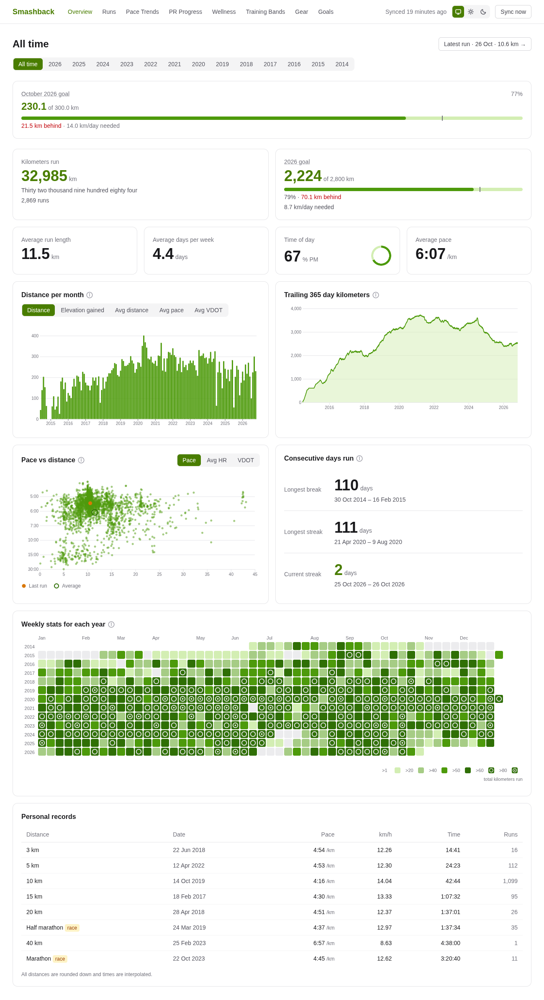

**Contents:** [Why it exists](#why-it-exists) · [Interactive by design](#interactive-by-design) · [Features](#features) (Overview, Runs, Run page, Pro Map, Pace Trends, PR Progress, Wellness, Training Bands, Gear, Goals) · [Data sources](#data-sources) · [Running it](#running-it) · [Stack](#stack)

## Why it exists

[Smashrun](https://smashrun.com) had the best charts for a long running history, but it is abandonware. [Dreeve](https://github.com/dreeveapp/dreeve), a self-hosted multi-sport dashboard, is too cycling-focused: its maintainer [found Smashrun's charts too runner-focused](https://github.com/dreeveapp/dreeve/issues/2880) to add.

So Smashback is a running-first, self-hosted replacement for your own data.

## Interactive by design

The charts are not pictures. Most of the value is in moving the pointer over them:

- **Linked hover.** On the Overview, pointing at a chart selects a set of runs and highlights those same runs in the other charts.
- **One cursor across charts.** On a run, hovering one chart moves a cursor on all of them and a marker along the route map. On Wellness, hovering marks the same day on every chart.
- **Brushes.** Drag a timeline to change the window of Pace Trends, PR Progress, Wellness and Training Bands (Pace Trends, Wellness and Training Bands also have 3 mo to all time presets). Drag across the speed chart or the Analyze Run strip to summarise a stretch or a group of runs.
- **Tooltips everywhere**, and an ⓘ next to every chart title that explains how to read it.
- **Clicks go somewhere.** Clicking a run in a chart opens its run page; clicking a distance bar drills into that period.
- **Keyboard.** Charts with a cursor are one Tab stop: Wellness, Training Bands, Goals, Analyze Run and the Pro Map graph. Left and Right step the cursor (or move between dots in Analyze Run), Home and End jump to the ends, Escape clears the cursor and hides the tooltip, and Enter opens the run in Goals and Analyze Run. The run page's pace variability wheel, HR zone bar and rank histograms are Tab stops too, with Escape hiding the tooltip. The Overview's linked hover is mouse-driven.

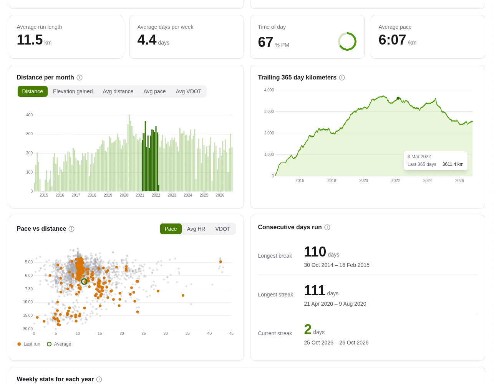

*Hovering the trailing-kilometers line at one day selects the runs of the 365 days before it: the distance bars show those runs' share of each month, and the scatter turns them amber.*

Metric only (km, min/km, m, °C). The theme is System, Light or Dark (a switch in the nav).

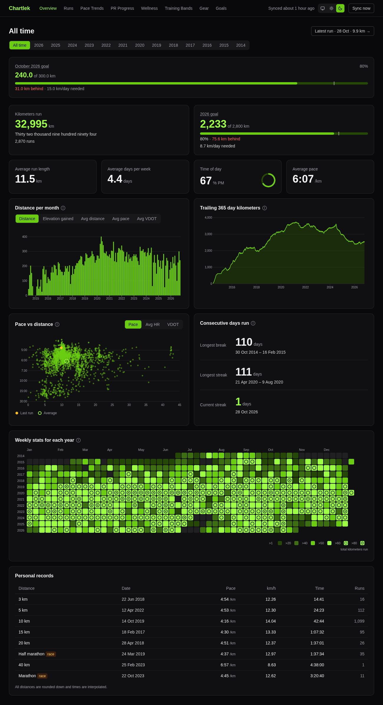

## Features

### Overview

Pick All time, a year or a month; every widget follows.

- **Stat tiles:** kilometers run (with the number in words, Smashrun-style), average run length, days run per week, time of day, average pace.
- **Goals:** a yearly goal tile beside kilometers run and a monthly goal widget (see [Goals](#goals)).
- **Distance per period:** bars per month, week or day; a button group switches the metric to elevation gained, average distance, pace or VDOT.
- **Trailing days:** the rolling distance of the last 365 days (90 in a year view, 7 in a month view).
- **Pace vs distance:** every run as a dot; the y axis can be pace, average HR or VDOT. The last run is amber and a ring marks the average.
- **Consecutive days run:** longest streak, longest break and the current one, with dates.
- **Weekly stats for each year:** a heatmap of weekly kilometers (a day calendar in year and month views).
- **Personal records** for 3 km up to 100 km, with a race tag where the record was a race.

**Linked hover** is the heart of it. Hover any of these and the matching runs light up in the others:

| Hover | Selects |
|---|---|
| Trailing line, at a day | the runs in the window ending that day |
| Scatter, in the plot | every run to the right of and above the pointer: longer and faster (or higher HR or VDOT) |
| Scatter, over the bottom axis | every run longer than that distance |
| Scatter, over the left axis | every run faster (or higher) than that value, at any distance |
| Distance bars | the runs of that bar's period |
| Heatmap cell | the runs of that week or day |
| Heatmap legend bucket | every cell in that bucket |
| A streak or break row | the runs in that span |

The scatter shows the selection as amber dots (the rest fade) and moves the average ring to the selection's mean; the bars show the selection's share inside each bar; the heatmap fades the cells outside it. That makes questions like "which runs were longer and faster than this one?" or "what did my last year before that peak look like?" a single hover.

### Runs

Every run by year and month, sortable by column. Click a gear tag (in the list or the run header) to list every run with that gear; click a "No gear" chip to list the runs Strava has no gear for, with a Suggested column of the shoes you most likely wore. Rows carry gear tags and race, PR, workout and treadmill chips. The **PR** chip marks runs Garmin flagged as a personal record; **workout** marks runs with a warm-up, recoveries, a cool-down or repeated active steps.

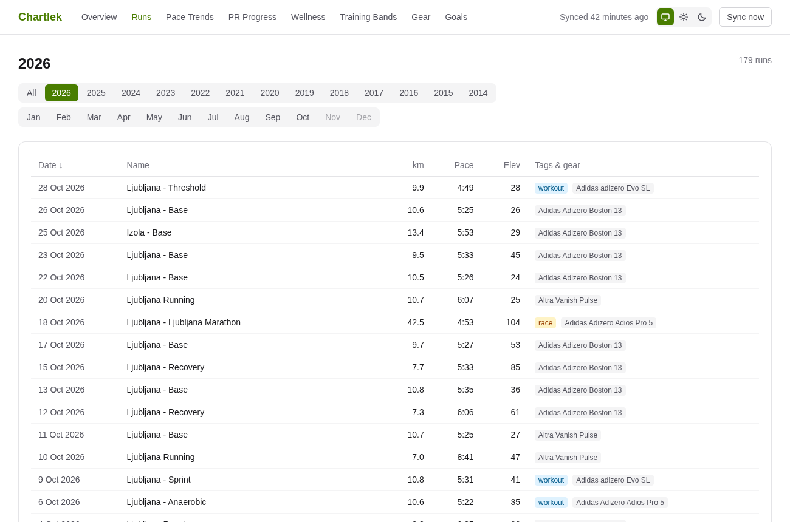

### Run page

Everything about one run.

**Header and tiles.** Weather at the start (condition, temperature, humidity, wind, rain, with night variants), Strava gear, links to Garmin and Strava, previous and next run, and a day picker. Tiles for distance, time (with elapsed and moving), pace, calories (as a food equivalent), HR and cadence. **GAP** under the pace is Garmin's grade-adjusted pace: the flat-ground pace your effort on the hills was worth.

**Performance index.** Each run gets a VDOT score: Jack Daniels' estimate of the VO2max a run implies. It puts every distance and every effort on one scale, so a 5K and a long run can be compared (one point is worth about 2% of race time, and easy runs score lower because they aren't all-out). The card shows it on a strip of **37 fixed pace zones**, coloured from walking to "zoom" and the same for every run, so improvement shows as a shift along the strip. Beside it is an **estimated finish time**: the button steps the same VDOT through 5K, 10K, half marathon and marathon without a request.

**Notables.** Pills for what is notable about the run, compared with your earlier runs:
- longest run, fastest run for a similar distance (within 10%), most elevation gain, hottest and coldest run, earliest and latest start. These name the longest window they hold for: the last 1, 3, 6 or 12 months, or ever;
- run during sunrise or sunset, run on a given moon phase, first run at a new place, first run of the year, extends your longest streak, passed N thousand km lifetime. These have no window.

**Workout.** Runs Garmin recorded as a structured workout get a card with the warm-up, active, recovery, rest and cool-down totals (distance, time, pace). Garmin gives totals per step type, not per rep.

**Shape of the run.**
- **Pace variability wheel:** one wedge per 100 m clockwise from the start; the longer the wedge, the further that stretch was from your average speed, faster or slower. The number is the average gap as a percentage of average speed. Hover a wedge to see which stretch it is.
- **Elevation profile** with gain, loss and a **hill difficulty** from 1 to 5, rated from gain per kilometer.
- Two histograms rank the run: the longest runs, and the runs of a similar distance by pace (amber marks this run).

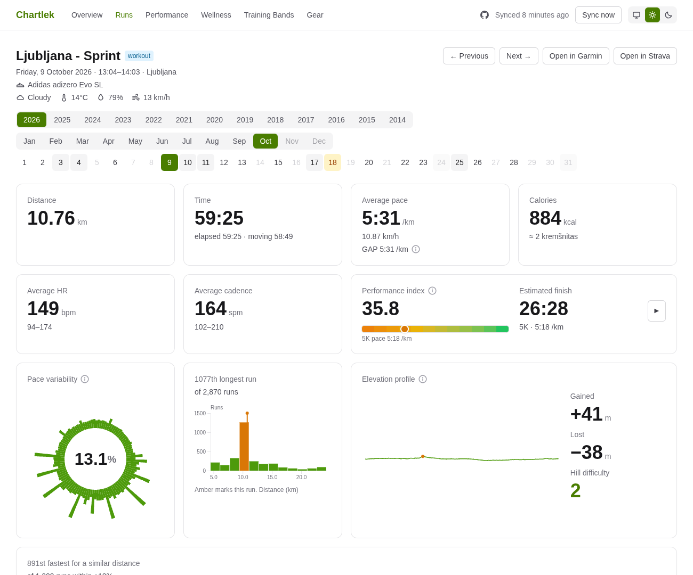

**Charts with one cursor.** The route map (Mapbox, with terrain: hillshade, contours, peaks), the speed chart (per 100 m or per km), the elevation profile and the elevation, heart rate and cadence charts all share one distance cursor. Hover any of them and the same distance is marked on the others and as a marker on the map. Drag across the speed chart to summarise a stretch (time, pace, HR, cadence of the selection). The heart rate line is coloured by zone, with the zone bands drawn behind it.

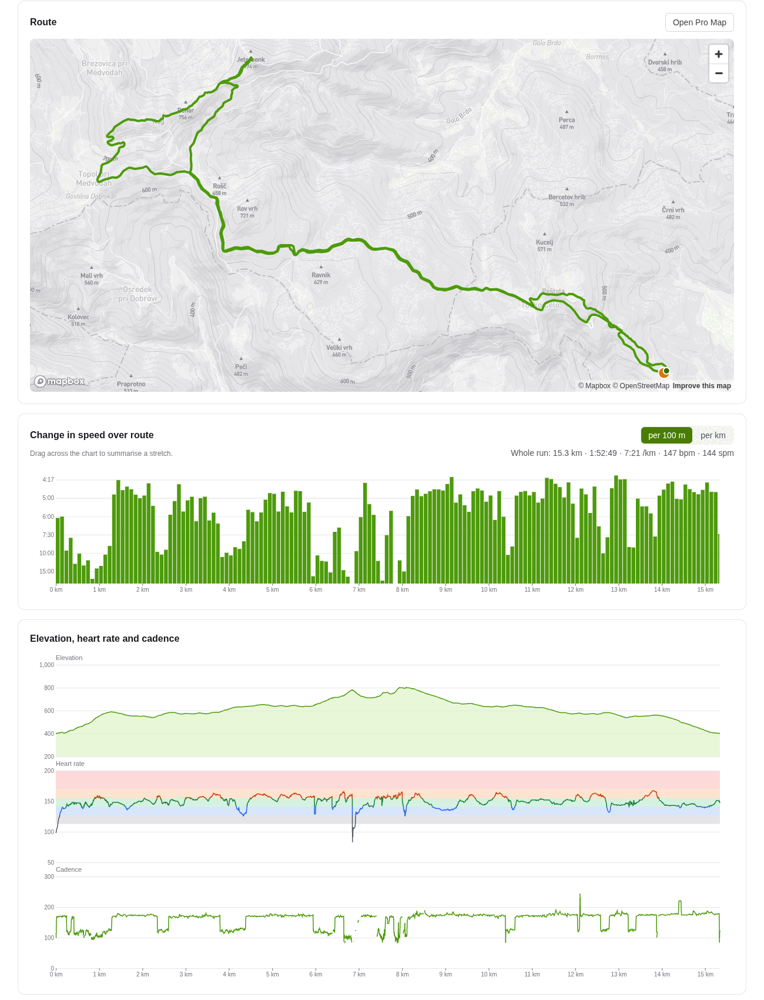

**Physiology.**
- **Heart rate zones:** a stacked bar of the time in each of the run's zones, with the zone ranges. Garmin's zones move with your resting HR, so each run uses the zones it was run with, read from its FIT file; older runs show estimated zones, labelled as such (see [Data sources](#data-sources)).
- Aerobic and anaerobic effect, training load, Body Battery change and intensity minutes from Garmin, and running dynamics (ground contact, vertical oscillation, stride length, vertical ratio, running power and normalized power) when recorded.
- **Going in:** how you arrived at the run, from Garmin wellness: that morning's resting HR (and 7-day average), last night's HRV against your baseline, sleep duration and score, and Body Battery at wake.
- **Fastest runs at this distance** over the last 90 days, 180 days, 365 days and all time.
- **Runs in the prior 90 days:** every run before this one as a dot strip (by distance, pace, VDOT or heart rate) above a one-mark-per-day timeline. Drag a brush over the strip to read the share, hours, distance and count of the runs inside it; hover or click a dot to see or open that run.

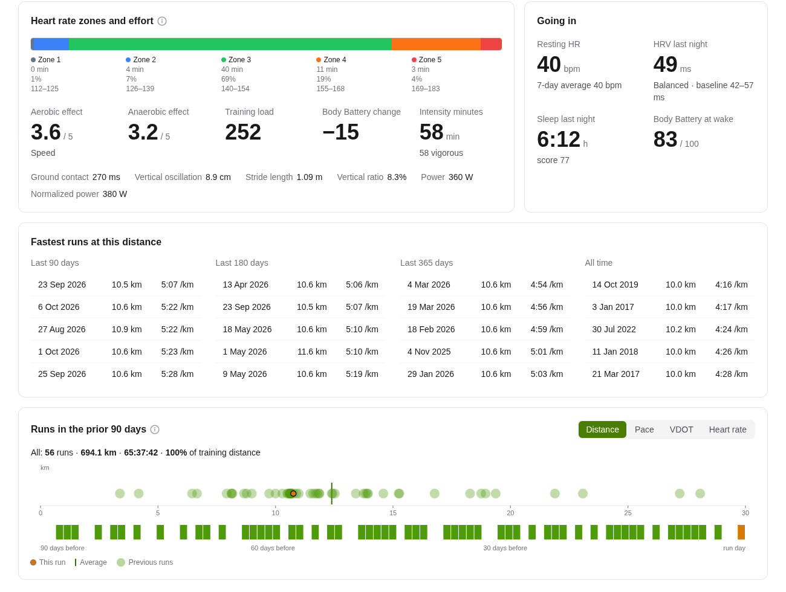

### Pro Map

A full-page map of one run, from the route card's Open Pro Map button. It needs the public `MAPBOX_TOKEN` (see [Running it](#running-it)); without one, or for a run without a GPS route, there is no button and the page redirects back to the run. The route is coloured by a metric you choose: **pace** (the 37 pace zones), **heart rate** (the run's own zones), **grade** or **cadence**.

- **Distribution bars** under the map show the time spent in each bucket of the metric. Click a bar to select that bucket on the map (the rest dims); click again for it and everything above; again for it and everything below; once more to reset. The legend shows distance, time, pace, HR and cadence of the selection.
- **Fastest segments:** the fastest 250 m, 400 m, 1 km, 5 km, 10 km, half marathon and marathon inside the run, each with time, pace and VDOT. Click one to isolate that stretch on the map.
- **Splits** per kilometer, showing the current metric. Click a split to isolate it.
- **Change in pace** graph (per 100 m): hover it and a marker follows on the map; hover a metric button and that metric is overlaid on the graph. It is a Tab stop with Arrow, Home, End and Escape.

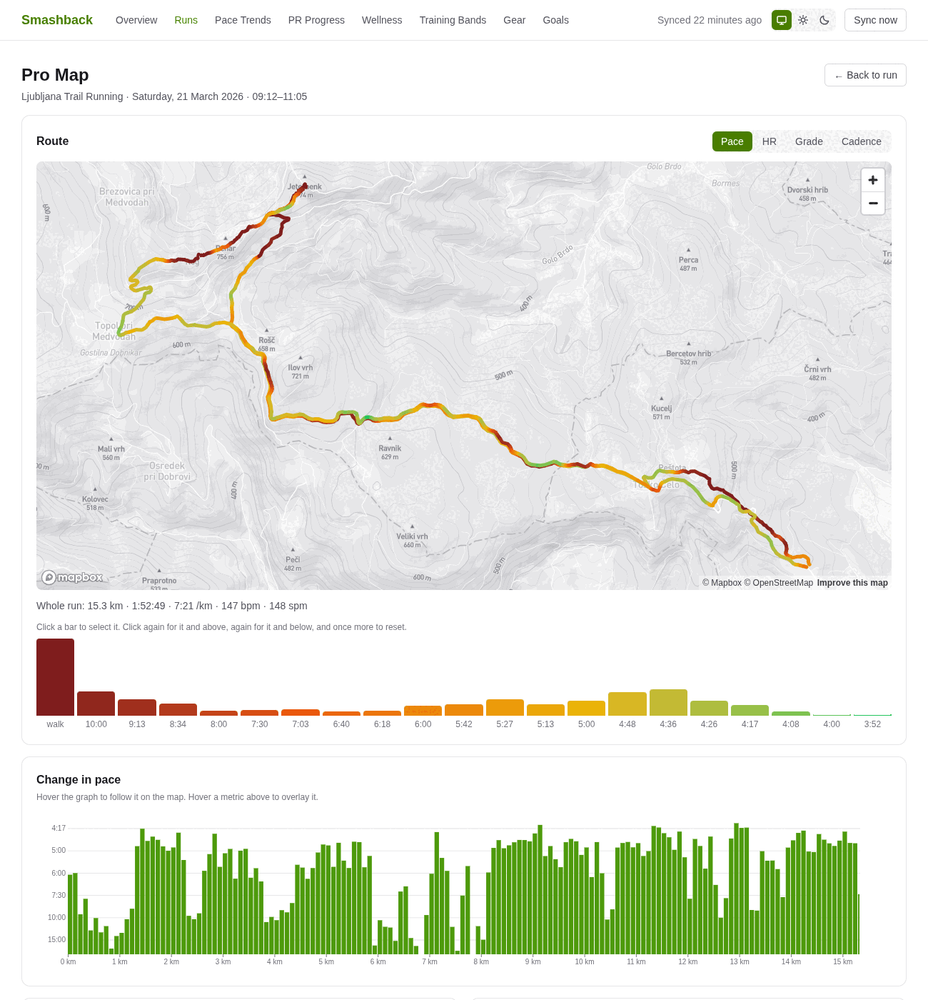

### Pace Trends

Is your fitness going up? Every run is a muted dot at its VDOT; the brighter amber dots are the top three runs of each 30 days. A band shows the fitted trend through those top runs, with the **change in VDOT per week** and what that is worth as time off your estimated finish for 5K, 10K, half or marathon. Choose a window from 3 months to all time or drag the timeline; toggles exclude pauses or show races only.

An **overlay** adds resting HR (7-day average), HRV or sleep hours on a second axis, so you can see fitness against recovery. It changes nothing about the trend. Click a dot to open the run.

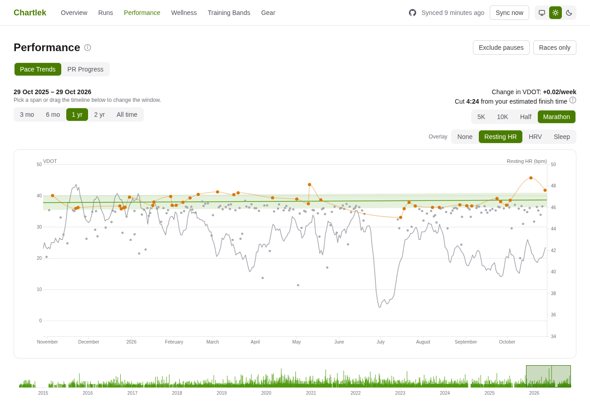

### PR Progress

Every run by distance (log scale) and pace. The solid line is your all-time best at each benchmark distance, so everything above it is still to be achieved; the dashed line is your best inside the window you brush on the timeline below.
- **PRs you can beat** predicts each distance from your best VDOT run of the last 30, 60 or 90 days, or from any run you click.
- **Magic PRs** shows the next round time below each PR (the next sub-20:00, the next sub-1:40) with the three closest targets pulsing.

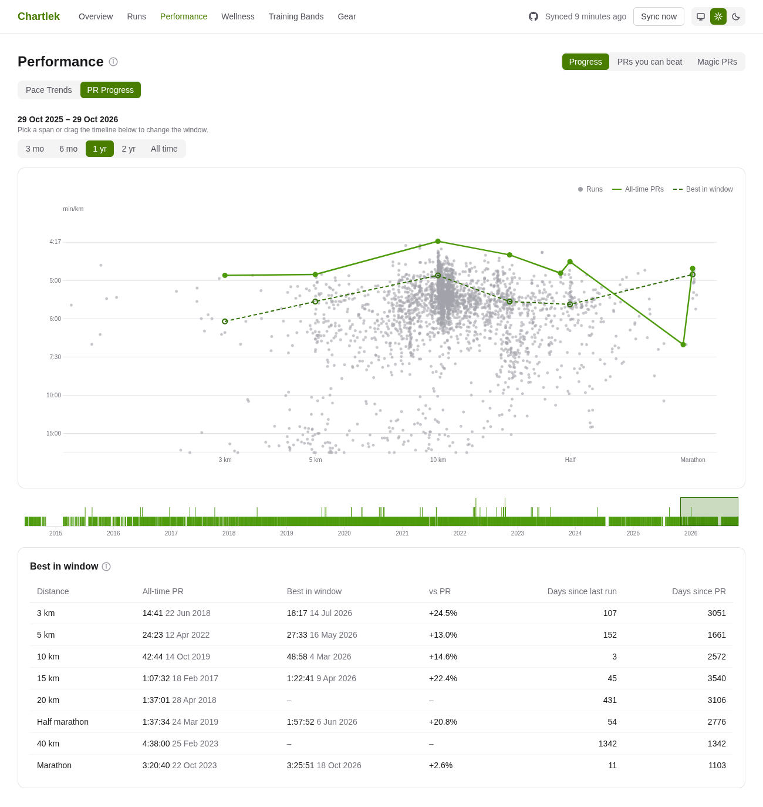

### Wellness

Garmin health data for your whole history, on one shared timeline and one hover cursor. Days Garmin has no value for are gaps.

- **Resting heart rate:** daily dots with a 7-day average.
- **Heart rate variability:** nightly HRV over Garmin's baseline band, each dot coloured by Garmin's status for that night (balanced, unbalanced, low or poor).
- **Sleep:** hours asleep stacked as deep, light and REM, with the sleep score on a second axis and a dashed line for Garmin's sleep need (from 2024).
- **Body Battery:** the day's range from lowest to highest.
- **Stress:** the daily average.
- **Weight:** weigh-ins with a 30-day trend.
- **Top-run VDOT:** the fitness line from Pace Trends, for comparison.
- **Time in heart rate zones per week:** your training load by zone, from every run.

Hover any chart and the same day is marked on all of them, so you can read a bad night, a low HRV and a slow week together. Each chart is one Tab stop: Left and Right step a day, Home and End jump to the ends of the window.

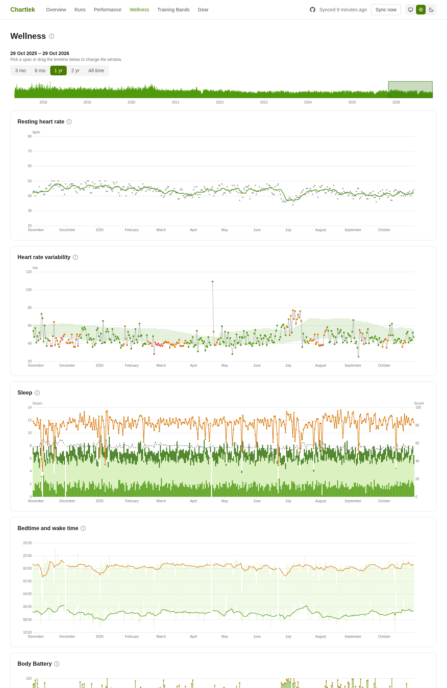

### Training Bands

Your weekly training time, stacked by **band**: a slice of intensity. Choose what to slice by:
- **Pace:** the 37 pace zones, grouped as Walk, Easy, Steady, Tempo and Fast.
- **Heart rate:** time in your five zones, each run using its own.
- **Grade:** seven slope buckets, from steep downhill to steep uphill.

**Absolute** shows hours per week; **%** shows each band's share of the week's running, so hiding bands shows how much of your running they are. Toggle bands on and off, pick a window with the presets or the timeline brush, and hover or arrow through the weeks for the tooltip. It answers "how much of my running was actually easy?".

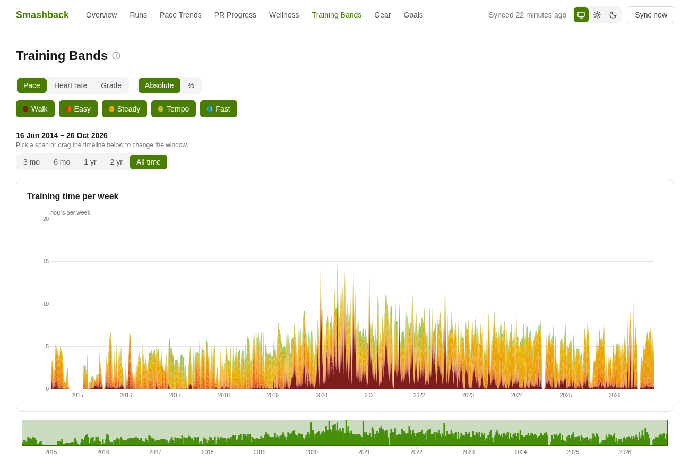

### Gear

Your Strava shoes, read-only: runs, distance, time, last 12 months and last used per pair, plus distance per month and distance over time charts (retired shoes are off until you toggle them). Runs linked to Strava without gear are listed so you can fix them there; Smashback never writes to Strava.

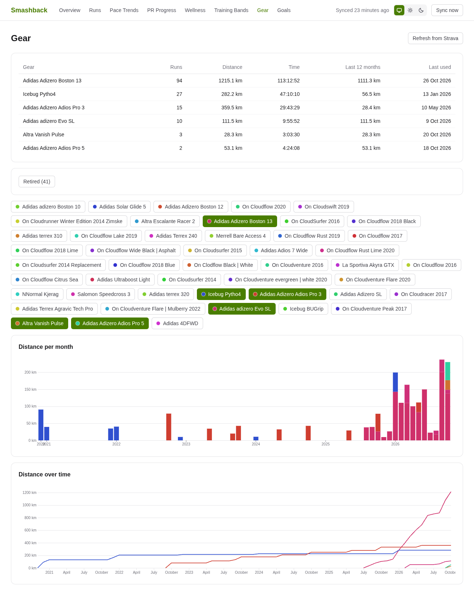

### Goals

Monthly and yearly distance goals. The Overview shows the yearly goal as a tile and the monthly goal as a widget; each links to the goal's page.

- **Direct path:** the straight line from zero to the target across the period. How far above or below it you are is "ahead" or "behind", in km.
- **Needed per day:** what is left divided by the days left, today included, next to your average of the last 28 days.
- **Open-today rule:** until you have run today, the expected distance counts days through yesterday, so you aren't marked behind for a run you haven't done yet.
- **Catch-up line:** when you are behind, a dashed line runs from where you are to the target at the end of the period. Its colour gets stronger the harder the catch-up is compared with your recent average, and fades when it is within reach.
- **Manage them:** Goals in the nav, then New goal (choose monthly or yearly and a distance in km). The goal page has Edit and Delete, and the Overview's "Set a monthly goal" and "Set a yearly goal" links open the form for the current period.
- **Hover a day:** a past day shows where you were, a future day shows the average per day you would then need. Click a run day to open that run; the chart is also a Tab stop with arrow keys and Enter.

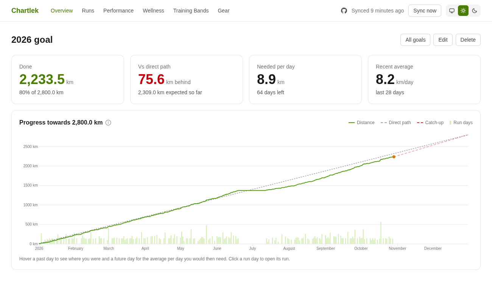

## Data sources

| Source | What it supplies |
|---|---|
| [Garmin Connect Personal API](https://developer.garmin.com/gc-developer-program/personal/personal-api/) | The primary source: run summaries, the FIT (or TCX) originals for tracks, and wellness (daily summary, HRV, weight, sleep, HR zones). Synced hourly. |
| Strava API | Fills the years before Garmin, links runs to Strava, and reads gear (read-only: nothing is written back). |
| Smashrun API | Recordings for the pre-Garmin runs, and calories and races. |
| [Open-Meteo](https://open-meteo.com) | Weather at each run's start, with sunrise and sunset. |
| Mapbox | Map tiles and terrain (Mapbox GL JS). |

**Per-run HR zones.** Your zones change over the years (resting HR moves them), so a fixed set would misfile old runs. Each FIT original carries the zones the watch used and the time spent in each, which Smashback reads directly, so every run is judged against its own zones. Runs recorded before the watch stored zones get **estimated** zones from the zones of that period and the time in each from the track; they are labelled Estimated wherever they appear. Training Bands, the run's HR chart and the Pro Map all use the run's own zones.

Smashback only reads. All data stays in SQLite under `storage/`.

## Running it

Requirements: Ruby 4.0.9, SQLite, and Node (only to run the JavaScript tests; there is no Node build).

Create a `.env` with these variables (names only, set your own values):

- `GARMIN_API_TOKEN`: your Garmin Personal API key.
- `STRAVA_CLIENT_ID` and `STRAVA_SECRET`: your Strava API app. Click Connect Strava in the nav once to authorise.
- `SMASHRUN_USERNAME` and `SMASHRUN_PASSWORD`: only for the pre-Garmin backfill.
- `MAPBOX_TOKEN`: a public `pk.` token. Never use a secret `sk.` token.

Make your own credentials first. The committed `config/credentials.yml.enc` is encrypted with the owner's key, so a fresh clone can't open it:

```bash
rm config/credentials.yml.enc
bin/rails db:encryption:init # prints three keys; copy them
bin/rails credentials:edit   # creates config/master.key (git-ignored) and a new credentials file
```

Paste what `db:encryption:init` printed into the credentials editor, as the `active_record_encryption` entry with `primary_key`, `deterministic_key` and `key_derivation_salt`. They encrypt the stored Strava tokens, so Strava can't connect without them.

```bash
bin/setup                    # install gems, prepare the database, then start bin/dev (--skip-server to just set up)
bin/dev                      # later: Rails, the Tailwind watcher and Herb on http://localhost:3000
```

**First run.** In order:

1. Sync Garmin: press Sync now in the nav, or `bin/rails activities:sync`. It imports your runs, downloads each run's original and builds the tracks.
2. `bin/rails activities:download` only if some runs still lack an original (a failed download is also retried by the next sync). It is slow, so split it across processes if you have thousands of runs.
3. Optional, for the years before Garmin: click Connect Strava in the nav, then `bin/rails strava:fetch`, then `bin/rails smashrun:fetch` (they need the Garmin sync first).
4. `bin/rails activities:hr_zones`, then `bin/rails activities:bands`: per-run HR zones and the Training Bands data for runs that are already stored. Run bands after hr_zones.
5. `bin/rails wellness:backfill`: Garmin wellness history, newest first, resumable.
6. Optional: `bin/rails weather:fetch` for weather on older runs (the sync only fetches the last 60 days).

After that, `Sync now` and the hourly job in production keep everything current. Other tasks:

```bash
bin/rails activities:resync      # full resync, deletes runs missing on Garmin
bin/rails activities:reprocess   # rebuild tracks and metrics from stored originals
```

See `AGENTS.md` for every task and its options.

Tests:

```bash
bin/rails test
node --test test/javascript/*_test.mjs
bin/ci                       # setup, style, security audits, tests, seeds
```

Deploy with Docker (port 9295, `./storage` mounted, config from `.env`). The container also needs `config/master.key` (mounted read-only; it opens the credentials that encrypt the stored Strava tokens), or `RAILS_MASTER_KEY` set instead (the key you made above):

```bash
docker compose up -d --build
```

Solid Queue runs inside Puma, including the hourly Garmin and wellness syncs. Put it behind your own TLS proxy; there is no authentication, so keep it on a private network.

## Stack

- Rails 8.1 on Ruby 4.0.9, SQLite, Solid Queue, Solid Cache and Solid Cable
- Hotwire (Turbo and Stimulus) with Importmap, no Node build
- D3 for every chart, Mapbox GL JS for every map, both vendored
- Tailwind CSS v4 with light and dark themes
- Minitest for Ruby, `node --test` for the JavaScript helpers

Product requirements, formulas and the data model are in [`docs/PRD.md`](docs/PRD.md); coding conventions are in [`STYLE.md`](STYLE.md).
